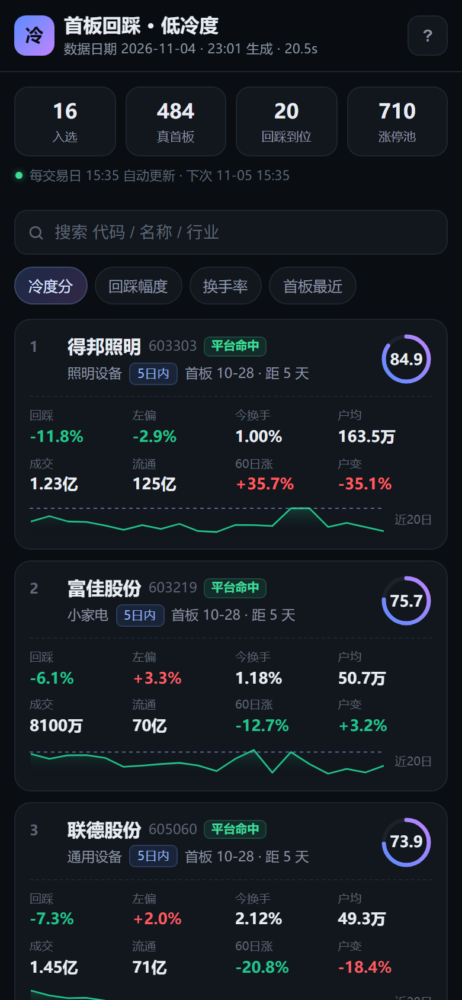
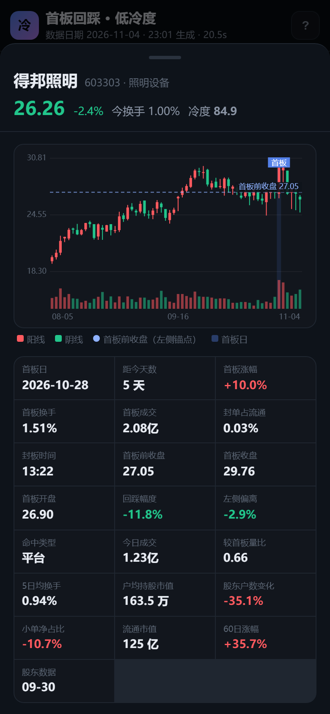

# 云端版：不用电脑，手机随时随地打开

本地版（`mobile/app.py`）要电脑开着、同一个 WiFi。云端版把「跑筛选」和「看页面」都搬到云上：

```
GitHub Actions（每个交易日尝试 4 次：15:40 / 16:20 / 17:40 / 20:10）
      │  ① python build_static.py  ← 拉东财数据、跑四条件、算出冷度分
      │  ② 把结果写进 docs/data/*.json
      ▼
GitHub 仓库（自动提交一次）
      ▼
GitHub Pages（静态托管，7×24 在线）
      ▼
手机浏览器 / 加到主屏的图标     ← 任何网络都能打开，家里电脑可以关着
```

前端是同一套代码：`ui/app.js` 启动时先探测 `api/status`——

- 探测成功 → **live 模式**，走本地服务（`mobile/app.py`，能手动刷新、能看实时状态）
- 探测失败 → **static 模式**，改读 `data/list.json` 等静态文件（就是 Pages 上的形态）

所以同一个 `index.html` 放在哪里都能跑，不用维护两份。

## 长这样

| 云端名单（4G 打开） | 云端详情（点卡片） |
| --- | --- |
|  |  |

注意右上角只有「?」——静态版没有刷新按钮，数据由 GitHub Actions 每天更新。

## 站点结构

```
docs/
├── index.html  style.css  app.js  sw.js  manifest.webmanifest  icon-*.png
└── data/
    ├── list.json               最新名单（含 16 只的 60 根 K 线，约 60KB）
    ├── archive/YYYY-MM-DD.json 每个交易日的完整快照
    ├── history.json           有哪些日期（页面顶部的日期标签）
    └── status.json            上次生成时间、下次更新时间
```

## 每天是怎么更新的

`.github/workflows/daily.yml`：

1. cron 排了 4 个时间点（UTC 07:40 / 08:20 / 09:40 / 12:10 = 北京 15:40 / 16:20 / 17:40 / 20:10，周一到周五）
2. 装 `requirements-ci.txt`（requests / pandas / akshare）
3. 先跑 `python -m unittest discover -s tests`（13 个用例，坏了直接红，不发布错误结果）
4. `python build_static.py --if-missing`——当天已有快照就跳过，所以后面几次只在前面失败时才真正干活，节假日也不会重复跑
5. 失败时 `tools/record_error.py` 把原因写进 `docs/data/last_error.json`（手机页头会显示）
6. 有变化就 `git commit` + `git push`，Pages 自动重新发布

为什么要试 4 次：东财对云机房 IP 会做短时限流（返回 `rc=102` 或 502，几分钟内所有请求都失败）。
脚本内部有全局限速、镜像轮换、20 秒冷却和整轮重试；万一整个小时都被限，下个小时的机器换了个 IP 基本就能成功。

GitHub 的定时任务偶尔会延迟几分钟到半小时才触发，对**日线**数据没有影响。如果那天 GitHub 完全没跑（平台故障），第二天会照常更新，也可以手动补。

## 已经部署好的地址

| 用途 | 地址 |
| --- | --- |
| **手机打开（收藏这个）** | https://ybl120579.github.io/stock-screener/ |
| 仓库 | https://github.com/ybl120579/stock-screener |
| 每天跑的任务 | 仓库 → Actions → 「每日选股」 |

手机上打开后用浏览器的「分享 → 添加到主屏幕」，桌面就会出现「首板·低冷度」图标，点开像 App 一样全屏。

> 站点是公开的（GitHub Pages 免费版只能公开），里面只有公开行情算出来的名单，不含任何密钥。想私密可以改成 Cloudflare Pages + 密码，或者只在本地用。

## 从零再部署一次（换账号时）

1. **推代码**：`python tools/deploy_github.py --token <你的token> --repo stock-screener`
2. **开 Pages**：仓库 → Settings → Pages → Source 选 `Deploy from a branch`，分支 `main`、目录 `/docs`
3. 等 1～2 分钟，打开 `https://<用户名>.github.io/stock-screener/`

`--token` 需要 `repo` + `workflow` 两个权限，用完就可以在 GitHub → Settings → Developer settings → Personal access tokens 里删掉；脚本只在内存里用它，不写进 `.git/config`。

## 手动补跑 / 重跑

仓库 → Actions → 「每日选股」→ Run workflow：

- 默认勾选「force」以外的行为：当天已有快照就跳过
- 勾上 `force`：无视已有快照，强制重跑（适合修了参数想立刻看结果）

## 想改筛选条件

改 `config.json`（阈值、权重都在里面）→ 提交 → 手动 Run workflow（勾 force）。

## 常见问题

**Actions 跑失败了**
先看手机页面顶部那行状态：失败时它会变红并直接写出原因（`data/last_error.json`），
不用登录 GitHub 也能知道是「限流」还是「代码报错」。

点进那次运行可以看完整日志。最常见是东财对云机房 IP 限流（`rc=102` / 502）。现在有多层兜底：

1. **快照**：东财 6 个镜像 → 新浪全市场（5577 只）；东财失败后 10 分钟内不再试探它；
2. **K 线**：东财 4 个镜像 → 腾讯 → 新浪；连续失败 2 次就熔断，全程走腾讯（约 1.3 秒/只）；
3. **涨停池**：东财接口 → 仓库里 `docs/data/pool/` 的历史快照 → 当日快照反推；
4. **交易日历**：东财 → akshare 新浪日历 → 工作日近似；
5. 整个筛选失败会等 30 / 90 秒各重跑一次；**当天还有 16:20 / 17:40 / 20:10 三次兜底定时任务**。

另外：K 线只抓到一半以下时脚本会**主动报错退出**，宁可这天不更新，也不会用残缺数据把正确快照覆盖掉。

所以偶尔失败一般不用管；连续两天没更新再看日志。

**看到「数据日期」不是今天**
那是当天还没跑成功（或者今天不是交易日）。页面顶部状态行会变黄/红提示；
当天 20:10 那次跑成功后会自动变成当天。

**Pages 打开是 404**
Settings → Pages 里确认分支和目录选的是 `main` / `/docs`，且 `docs/index.html` 确实推上去了。

**手机上打开很慢**
GitHub Pages 走的是海外 CDN，国内访问偶尔慢。可用性一般够用；如果实在慢，把仓库再挂一份到 Cloudflare Pages（同一个 `docs/` 目录，免费），或换成国内静态托管。

**数据要保密吗**
仓库是公开的，但里面只有公开行情算出来的名单，没有你的账号密钥。你的 API 密钥一个都不在这里（东财接口本身不需要 key）。
