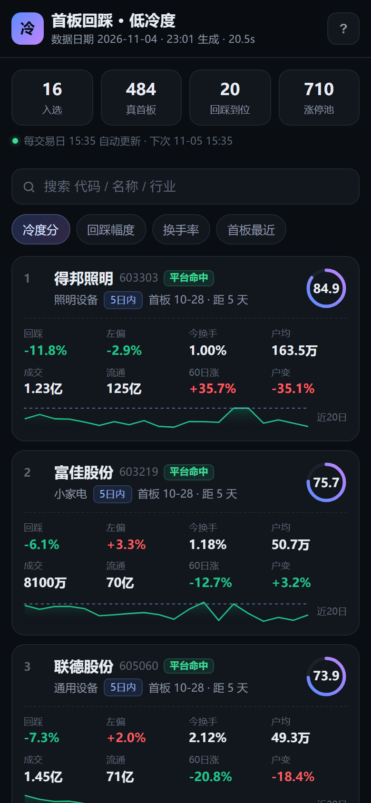
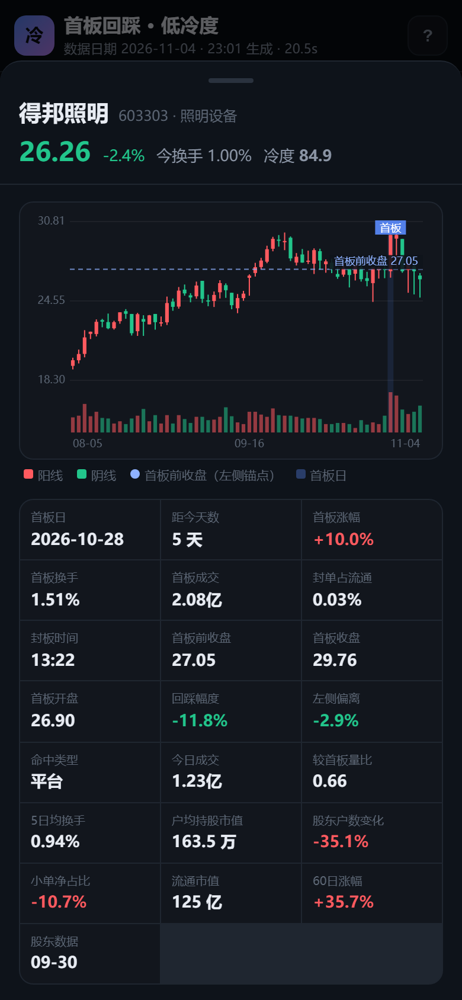

# 首板回踩左侧 · 低热度选股系统

按「5/10 日内首板 → 回踩到首板左侧平台 → 主板非 ST → 热度低、散户少」四个条件，
从全 A 股中筛选股票，输出可直接阅读的 HTML 报告 + CSV / Excel 表格。

数据源为东方财富公开接口（行情快照、日 K、涨停池、股东户数、人气榜、龙虎榜、资金流），
全部本地计算，不依赖任何付费数据。

## 快速开始

```bash
# 依赖：Python 3.10+、pandas、numpy、requests、akshare、openpyxl
pip install pandas numpy requests akshare openpyxl

# 跑最新交易日
python run.py

# 指定日期、强制刷新数据
python run.py --date 2026-11-04 --refresh

# 只看前 20 只，或临时改参数
python run.py --top 20 --set left_tolerance_pct=4 --set turnover_today_max=8

# 调出全部参数说明
python run.py -h
```

运行结束后：

```
reports/选股结果_2026-11-04.html   ← 打开这个看报告（自包含单文件，可离线分发）
reports/选股结果_2026-11-04.csv
reports/选股结果_2026-11-04.xlsx
reports/选股结果_2026-11-04.json
```

首次运行需要拉取约 400 只股票的日 K（8 线程并发，约 20–40 秒），之后按交易日缓存到
`cache/`，重复运行约 1 秒。`--refresh` 只在需要重取当日行情时使用。

## 四个条件如何落地

### 条件一：5 日内或 10 日内首板

- 从最近 10 个交易日（`T-10 ~ T`，共 11 个交易日的涨停池）取连板数 `lbc == 1` 的记录（首板）。
- 再回溯该股**首板前 30 个交易日**，若出现过涨幅 ≥ 9.7% 的交易日，则不算首板（排除接力板、
  也排除窗口内第二次涨停）。
- 首板不是窗口内最新一根涨停：**首板之后不得再出现涨停**（否则已经进入连板，形态不同）。
- 首板距今天数 `1–5` 个交易日归入「5 日内」，`6–10` 个交易日归入「10 日内」。
  当日涨停的股票无法回踩，自然被排除。

### 条件二：回落到首板左侧附近

以「首板前一日收盘价」为**左侧锚点**（首板起涨的平台位置），要求同时满足：

| 判定 | 规则 | 含义 |
| --- | --- | --- |
| 已回落 | `现价 / 首板收盘 − 1 ≤ −3%` | 确实从首板高点回落了 |
| 平台命中 | `|现价 / 首板前收盘 − 1| ≤ 3.5%` | 回到首板左侧平台 |
| 开盘价命中 | 首板日高开 > 2% 且 `|现价 / 首板开盘 − 1| ≤ 1.5%` | 强势首板跳空后，回踩到首板实体下沿 |

两个命中满足其一即可（报告里「命中」列标注是哪种）。

**补充规则（都在 config.json 里可调）：**

| 规则 | 参数 | 默认 | 说明 |
| --- | --- | --- | --- |
| 时间衰减 | `time_decay_max` / `time_decay_start_days` | 4 分 / 2 天 | 首板距今超过 2 天后，每多一天扣一点冷度分（最多 −4），放得越久形态越容易走坏 |
| 破位过滤 | `break_dip_pct` | 0（关闭） | 首板后收盘曾跌破「首板前收盘 −6%」→ 判为破位反抽直接剔除。20 天回测里打开它略差（见下文），所以默认关闭 |

每条剔除都会带一句人话原因（例如「没回到左侧：现价比首板前收盘 +4.4%（要求 ±3.5%）」），
手机端点顶部数字进「筛选漏斗」页可以按代码/名称查任意一只股票卡在哪一层。

### 条件三：去掉 ST、创业板、科创板

只保留 `600/601/603/605/000/001/002/003` 开头的主板股票，另外：

- 剔除名称含 `ST` / `*ST` / `退` 的；
- 剔除 `N`/`C` 开头的次新股，以及 K 线不足 45 根的新股；
- 剔除股价 < 2 元的仙股；
- 北交所不在数据源范围内（东财该接口不含北交所）。

### 条件四：热度不能太高、散户尽可能少

**硬过滤（不满足直接淘汰）**

| 指标 | 阈值 | 逻辑 |
| --- | --- | --- |
| 今日换手率 | ≤ 10% | 换手过高说明筹码在快速换手、人气旺 |
| 近 5 日平均换手率 | ≤ 12% | 持续活跃的票不是「冷」票 |
| 今日成交额 | ≤ 20 亿 | 大资金关注度 |
| 近 60 日涨幅 | ≤ 60% | 已经炒过一大波的票不碰 |
| 流通市值 | 10–1500 亿 | 太小的易被操纵，太大的拉不动 |
| 东财人气榜 | 不在前 100 | 人气榜前列即「热门股」 |

**冷度评分（0–100，用于排序，权重可改）**

| 因子 | 权重 | 打分方向 |
| --- | --- | --- |
| 户均持股市值 | 20% | 越高说明散户越少、筹码越集中（4 万 → 0 分，150 万 → 100 分，对数映射） |
| 今日换手率 | 20% | 越低越好（1% → 100 分，10% → 0 分） |
| 近 5 日平均换手率 | 15% | 越低越好（1.5% → 100，12% → 0） |
| 较首板日缩量比 | 12% | 今日成交量 / 首板日成交量，越缩量越好（0.25 → 100，1.0 → 0） |
| 股东户数变化 | 10% | 户数下降 = 筹码集中（−20% → 100，+20% → 0） |
| 今日成交额 | 8% | 越低越好（对数映射 0.4 亿 → 100，20 亿 → 0） |
| 近 60 日涨幅 | 8% | 越低越冷（−10% → 100，+60% → 0） |
| 今日小单净流入占比 | 7% | 越小说明散户买入越少（−15% → 100，+15% → 0） |

另外，首板之后若再上龙虎榜，每次扣 20 分（最多扣 40 分）—— 上榜意味着游资/机构关注度升温。

## 参数

所有阈值集中在 `config.json`（不存在时用 `screener/config.py` 里的默认值），也可用
`--set key=value` 临时覆盖，无需改代码。

| 参数 | 默认 | 说明 |
| --- | --- | --- |
| `board_window_days` | 10 | 首板最远回溯（首板距今 ≤ 10 个交易日） |
| `short_window_days` | 5 | 「5 日内」分界（距今 ≤ 5 个交易日） |
| `first_board_lookback_days` | 30 | 首板前无涨停的回溯天数 |
| `limit_up_pct` | 9.7 | 主板涨停判定阈值（%） |
| `pullback_min_pct` | 3.0 | 最小回踩幅度（%） |
| `left_tolerance_pct` | 3.5 | 左侧锚点容差（%） |
| `float_mcap_min_yi` / `float_mcap_max_yi` | 10 / 1500 | 流通市值区间（亿） |
| `turnover_today_max` | 10 | 今日换手上限（%） |
| `turnover_5d_max` | 12 | 5 日均换手上限（%） |
| `amount_today_max_yi` | 20 | 今日成交额上限（亿） |
| `gain60_max_pct` | 60 | 60 日涨幅上限（%） |
| `exclude_hot_rank_top` | 100 | 剔除东财人气榜前 N（0 = 关闭） |
| `lhb_after_penalty` | 20 | 首板后再上龙虎榜的扣分 |
| `score_min` | 0 | 入选最低冷度分 |
| `top_n` | 50 | 报告最多展示数量 |
| `weights` | 见上表 | 冷度评分权重 |

## 报告内容

- **四个条件如何落地**：阈值与判定方式的可读说明；
- **筛选漏斗**：窗口内涨停池 → 逐级收敛到最终入选，每级都能核对；
- **入选结果表**：可点击表头排序、输入关键字过滤，一键下载 CSV / Excel；
- **逐股详情**：近 60 根日 K（标注首板日与左侧锚点线）、18 项关键指标、冷度评分构成；
- **筛选日志**：每条被剔除记录的淘汰阶段与原因，参数与权重快照。

## 目录结构

```
stock-screener/
├── run.py                 # 命令行入口（出报告）
├── config.json            # 可调参数
├── verify.py              # 独立复核脚本（抽查首板/回踩/涨停池）
├── backtest.py            # 冷度分回测（历史收益验证）
├── tests/test_screen.py   # 单元测试（无需联网）
├── screener/
│   ├── config.py          # 默认参数 + 配置合并
│   ├── datasource.py      # 东财接口 / akshare / 本地缓存
│   ├── screen.py          # 四条件筛选 + 评分
│   └── report.py          # HTML / CSV / Excel 报告
├── mobile/                # 手机 App（PWA + 每日自动更新），见 mobile/README.md
│   ├── app.py             #   后端服务（仅标准库）
│   ├── ui/                #   前端页面
│   ├── data/              #   每日快照
│   └── *.bat              #   启动 / 开机自启 / 防火墙
├── docs/                  # 云端静态站点（GitHub Pages 发布目录，见 CLOUD.md）
├── build_static.py        # 跑一次筛选 → 生成 docs/（云端定时任务调用）
├── returns.py             # 给历史名单补算「当天/次日涨跌幅」
├── tools/deploy_github.py # 一键建仓库 / 推代码 / 开 Pages
├── tools/record_error.py  # CI 失败时把原因写进页脚
├── cache/                 # 按交易日缓存（可删）
└── reports/               # 输出报告
```

## 两套系统（手机端两个胶囊）

页面顶部有两个胶囊互相切换，共用同一个站点、同一份定时任务：

| 胶囊 | 路径 | 逻辑 | 更新 |
|---|---|---|---|
| **首板冷度** | `/` | 5/10 日内首板 → 回踩首板左侧 → 主板非 ST → 低热度散户少 | 每交易日 11:00 |
| **强趋势** | `/trend/` | 均线多头排列 + 贴近 20 日新高 + 有量有弹性，只做强势股 | 每交易日 11:00 |

> 两套系统在 11:00 取的是**盘中快照**（当日 K 线为当时价格），不是收盘价；回测口径是收盘价，所以盘中信号和回测会有偏差。

## 手机 App

**已经上线，手机上直接打开**：<https://ybl120579.github.io/stock-screener/>
（iOS Safari / 安卓 Chrome 里「添加到主屏幕」，桌面就会出现「首板·低冷度」图标，全屏像 App 一样用）

- 云端版每交易日自动跑 4 次（**11:00 / 11:20 / 11:40 / 12:00**），成功了后面的自动跳过
- 电脑关着、人在外面、只有 4G 也能看
- 每只股票卡片上直接显示 **当天涨跌** 和 **次日涨跌**；顶部汇总「当天 N 只平均 / 次日平均 + 胜率」，
  历史日期一样能看，还能按「次日涨跌」排序 —— 方便回头检查选出来的票到底跑得怎么样
- 架构与部署细节见 [CLOUD.md](CLOUD.md)

| 云端名单 | 云端详情 |
| --- | --- |
|  |  |

**在自己家的局域网里用**（能手动刷新、数据现拉）：双击 `mobile/启动手机App服务.bat`，
手机连同一 WiFi 打开窗口里打印的地址，每个交易日 11:00 自动更新。
如果到点那次没成功（比如数据源限流），会按 **10 → 20 → 40 → 60 分钟**退避重试，
一天最多试 5 次，不会每 30 秒猛打一次把 IP 封得更久；电脑关机时错过的那次，下次启动会立刻补跑。
详见 [mobile/README.md](mobile/README.md)。

前端是同一套代码，启动时先探测本地服务（live 模式，能刷新）还是读静态文件（static 模式，云端版）。

`python verify.py` 会跳过筛选模块，直接从原始接口重算几只票的首板日涨幅、首板前后涨停情况、
回踩幅度，并用 akshare 独立拉涨停池交叉核对连板数，用来确认报告里的数字没有算错。

## 数据源与兜底

东财接口对同一 IP 有短时限流（返回 `rc=102` 或直接断连），云端机房 IP 尤其容易中招。
系统做了三层兜底，任何一层可用就能跑出结果：

| 数据 | 首选 | 兜底 1 | 兜底 2 |
| --- | --- | --- | --- |
| 全市场快照 | 东财 clist（6 个镜像域名轮换） | 新浪 `Market_Center`（5577 只） | 涨停池自带市值 |
| 日 K 线 | 东财 4 个镜像 | 腾讯 `ifzq.gtimg.cn` | 新浪 `CN_MarketData` |
| 涨停池 | 东财 `getTopicZTPool` | 仓库内快照 `docs/data/pool/DATE.json` | 当日快照反推（涨幅 ≥9.7% 且收盘=最高） |
| 交易日历 | 东财 | akshare（新浪日历） | 工作日近似 |

- 东财 K 线连续失败 2 次即熔断，本次运行全部改走腾讯（约 1.3 秒/只）；
- 东财快照失败后 10 分钟内直接走新浪，避免反复试探把限流窗口拖长；
- 每次成功抓到的涨停池都会存进 `docs/data/pool/`（保留最近 60 个交易日），
  东财整段不可用时仍能靠历史快照出名单；
- 抓不到 K 线超过一半时按失败处理并**重试**（不是直接退出），三次都不行才放弃并保留上一次的正确快照；
- 冷缓存 + 东财全封的实测（模拟云端：`SCREENER_LOW_CONCURRENCY=1`，无任何本地缓存）：
  新浪快照 5577 只 → 涨停池 507 条 → 腾讯 K 线 428/428 → **325 秒筛出 12 只**，
  人气榜/资金流取不到只记 `aux_missing`，不影响出名单。

## 测试

```bash
python -m unittest discover -s tests -v
```

19 个用例覆盖：板块/ST/次新判定、四条件各阶段的通过与否决分支（首板前有涨停、首板后再涨停、
未回踩到位、换手过高、成交额过大、超出时间窗口）、破位过滤开关、时间衰减的边界与单调性、
冷度分映射函数的单调性与缺失值中性化、涨停池反推逻辑、参数默认值（权重合计 = 1）。
另外校验「每条剔除都带非空原因」——手机端的「为什么没入选」靠它。
CI 在出报告前先跑这套测试，坏了就不发布。

## 当天 / 次日涨跌幅

名单是收盘后按当天数据选出来的，所以：

- **当天涨跌**：这只票在入选当天的涨跌幅（选它的那天它跌了还是涨了）
- **次日涨跌**：入选后**下一个交易日**相对入选当天收盘的涨跌（以当天收盘价为基准）

`returns.py` 会读 `docs/data/archive/*.json` 里的全部历史名单，用 K 线逐只算出：
`next_date` / `next_open_pct`（次日开盘）/ `next_close_pct`（次日收盘）/ `next_high_pct`（次日最高）/ `next_low_pct`（次日最低），
再补上 `day_summary`（当天 N 只平均、涨跌家数）与 `next_summary`（次日平均、胜率）。

`build_static.py` 每次跑完都会自动调它（跳过用 `--skip-returns`），所以云端每天的页面都带这两列。
单独补算历史：

```bash
python returns.py            # 补算 docs/ 下全部历史
python returns.py --days 30  # 只看最近 30 个交易日
```

实测（2026-11-06 之前）：

| 入选日 | 只数 | 当天平均 | 次日平均 | 次日胜率 |
|---|---|---|---|---|
| 11-04 | 16 | +1.1% | **+1.72%** | 87.5%（涨 14 / 跌 2） |
| 11-05 | 12 | — | **−2.25%** | 8.3%（涨 1 / 跌 11） |
| 11-06 | 22 | −2.66% | 等下一个交易日 | — |

两天一正一负，正好说明：**这是形态筛选，不是收益保证**，别拿单日结果当结论。

## 回测

```bash
python backtest.py --days 20        # 回测最近 20 个交易日
python backtest.py --days 60        # 长一点（首次会重建 K 线缓存，约 25 分钟）
python backtest.py --days 20 --refresh   # 强制重建 K 线缓存
```

它不依赖东财涨停池接口——涨停直接用 K 线判定（涨幅 ≥9.7% 且收盘 = 最高），
所以限流期间也能跑。对每个历史交易日重放四条件，再统计入选股票在 T+1 / T+3 / T+5 / T+10
的收盘收益、胜率，以及「同一批首板股不加条件」的基准，并按冷度分分五组看是不是分数越高越好。
输出 `reports/backtest_20d.json`（含逐日明细与逐只收益）。

`--set key=value` 可以临时改参数做对比，`--tag` 给输出文件加后缀：

```bash
python backtest.py --days 20 --tag base   --set break_dip_pct=0 --set time_decay_max=0
python backtest.py --days 20 --tag new                                              # 当前默认
python backtest.py --days 20 --tag decay4 --set break_dip_pct=0                    # 只开时间衰减
```

2026-10-09 ~ 11-05（20 个交易日）的实测对比：

| 版本 | 入选次数 | T+5 均值 | T+10 均值 | 冷度分 Q1 − Q5（T+10） |
| --- | --- | --- | --- | --- |
| base（都不开） | 516 | −2.8% | −6.0% | −3.9% vs −7.8%（差 3.9pp） |
| + 破位过滤 6% | 493 | −2.9% | −6.1% | — |
| + 时间衰减（当前默认） | 516 | −2.8% | −6.0% | −3.9% vs −8.0%（差 4.1pp） |
| 同期「全部首板股」基准 | — | −3.9% | −7.3% | — |

结论：破位过滤在这段样本里没带来好处（反而略差），因此默认关闭；时间衰减几乎不改变均值，
但让高分组的优势稍微更连续，所以保留（权重很小）。

### 更长一段：60 个交易日（2026-08-06 ~ 11-05）

`python backtest.py --days 60`：入选 1744 次、日均 29.1 只、60 天里每天都有入选。

| 持有 | 均值 | 中位数 | 胜率 | 同期「所有首板股」均值 |
| --- | --- | --- | --- | --- |
| T+1 | −0.05% | −0.11% | 47.4% | −0.22% |
| T+3 | −0.10% | −0.48% | 44.5% | −0.82% |
| T+5 | −0.06% | −0.78% | 44.5% | −1.49% |
| T+10 | −0.78% | −1.94% | 40.4% | −2.88% |

冷度分分组（T+5 均值）：Q1（最高分，71.3~78.2）**+1.2%**、Q2 +0.3%、Q3 −0.8%、Q4 −0.9%、
Q5（最低分，31.4~52.0）−0.2%——前四组基本单调，Q5 有点反弹，说明极低分里也有错杀。

结论：相对「随便买首板」每个周期都更好（T+10 差 2.1pp），但**绝对收益接近零**，
在 2026 年 8~11 月这段行情里不是赚钱策略；分数越高确实越好，但优势不大。

同一段 60 天里，把两条“可选规则”分别开关再跑一遍：

| 版本 | 入选次数 | 日均 | T+5 均值 | T+10 均值 | 冷度分 Q1−Q5（T+5） |
| --- | --- | --- | --- | --- | --- |
| 当前默认（时间衰减 4 分、破位关闭） | 1744 | 29.1 | −0.06% | −0.78% | +1.24% vs −0.20%（差 1.44pp） |
| 关掉时间衰减 | 1742 | 29.0 | −0.06% | −0.77% | +1.24% vs −0.15%（差 1.39pp） |
| 打开破位过滤 6% | 1671 | 27.9 | −0.07% | −0.74% | +1.11% vs −0.07%（差 1.18pp） |
| 同期「全部首板股」基准 | — | — | −1.49% | −2.88% | — |

结论（60 天口径和 20 天一致）：破位过滤少选 4% 的票、均值没变好、分数区分度还变窄了，
所以**继续关闭**；时间衰减对均值几乎无影响，但让高分组的优势略稳，**继续保留**（权重很小）。

> 提醒：回测样本小（20 个交易日、每天十几只）、市场环境单一，只能说明这套过滤在**这段行情里**
> 的表现，不能外推。冷度分是「热度低/散户少」的量化，不是涨跌预测。

## 什么时候跑都不会算错日期

- 收盘数据没出来之前（当天 15:05 前）运行，会自动用**上一个交易日**出名单，
  不会拿一个空涨停池把名单算成 0 只；
- 万一真的算出空名单，会直接报错并**保留上一次的名单**，不会用空的覆盖；
- 桌面版定时任务失败后按 10 / 20 / 40 / 60 分钟退避重试，一天最多 5 次。

## 已知限制

- 涨停池是**收盘封板**口径，盘中炸板后回封的票也在池内，但「首板」判定以收盘涨停为准；
- 股东户数为最近一次披露值（季度/月度），可能滞后 1–3 个月，报告里会标注统计截止日；
- 东财人气榜只覆盖前 100 名，「未上榜」不等于绝对冷门，但至少不在当前热门榜上；
- 龙虎榜数据由 akshare 提供，首板当日上榜属正常（涨幅偏离上榜），只对**首板之后**的上榜扣分；
- 前复权 K 线用于形态判断，若个股期间有分红送转，历史价格与实盘盘口会有差异；
- 系统只做「形态 + 热度」的机械筛选，不判断基本面、题材持续性与大盘环境。

## 交易计划（环境 / 仓位 / 出场）

从「只告诉你买什么」升级成「今天该不该做、做哪几只、买多少、什么时候走」。

| 模块 | 文件 | 做什么 |
|---|---|---|
| 市场环境 | `screener/regime.py` | 全市场涨停家数、炸板率、昨日涨停今日溢价 → good / bad |
| 首板质量 | `screener/quality.py` | 首封时间、炸板次数、封单占比、是否一字板、首板换手 → 0–100 分 |
| 板块地位 | 同上 | 首板当天同行业涨停数、是不是最先封的那只（龙头 1 / 跟风 2） |
| 事件风险 | `screener/events.py` | 未来 5 日解禁 → 剔除；近 30 日减持公告 → 扣分 |
| 交易计划 | `screener/screen.py` → `meta["plan"]` | Top5、单票 20%、同行业≤2、止损位、目标位 |

规则（都可在 `config.json` 改）：

```json
{
  "regime_gate": true, "regime_min_zt": 30, "regime_max_zhaban_pct": 45.0,
  "regime_min_premium_pct": -1.5,
  "min_board_quality": 0.0, "min_industry_zt": 0,
  "reject_release_in_days": 5, "reject_reduce_days": 30, "reduce_penalty": 6.0,
  "plan_top_n": 5, "plan_position_pct": 20.0, "plan_max_per_industry": 2,
  "plan_stop_pct": 3.0, "plan_time_stop_days": 3,
  "bt_entry": "open", "bt_cost_pct": 0.2
}
```

手机端顶部会出现一张「今日策略」卡：退潮期是红色「建议空仓观望」，点进去是当天的交易计划（Top5 + 现价 + 止损 + 目标 + 仓位）。

### 环境判定的口径

- **涨停家数**：全市场（含创业板/科创板）收盘涨停且封住的数量，`< 30` 视为冰点
- **炸板率**：摸过涨停但没封住的比例，`> 45%` 视为退潮
- **昨日涨停溢价**：昨天涨停的那批股票，今天平均涨幅，`< -1.5%` 视为亏钱效应
- 任一条命中 → 退潮期，建议空仓；三条都健康 → 正常执行

## 回测（交易口径）

`backtest.py` 现在支持真实执行假设，命令：

```bash
python backtest.py --days 60 --topn 5 --cost 0.2        # 次日开盘买 + 双边成本 + 只取前 5
python backtest.py --days 60 --no-rule                  # 只看持有收益
python backtest.py --days 60 --no-regime                # 不按环境过滤
```

2026-08-07 ~ 11-06（60 个交易日）的结果：

| 口径 | 样本 | 均值 | 中位 | 胜率 |
|---|---|---|---|---|
| 收盘→次日收盘（旧口径，买不到） | 265 | −0.1% | −0.3% | 42.3% |
| 次日开盘买 → 规则出场（止损 5%） | 265 | **−0.8%** | −1.7% | 22.3% |
| 同日「所有首板股」基准 T+5 | — | −1.5% | — | — |

结论要说得直白：**扣掉成本、按能真正成交的价格算，这套东西这 60 天是微亏的**；
它比“随便买首板”好，但不是赚钱机器。止损设 3% 会更差（−1.2%）、设 5~8% 略好（−0.8%），
原因是这类票次日经常先跌 3% 再拉——止损太紧会被洗掉。

## 免责声明

本项目仅为技术研究与数据整理，输出结果不构成任何投资建议。股市有风险，交易需谨慎。
