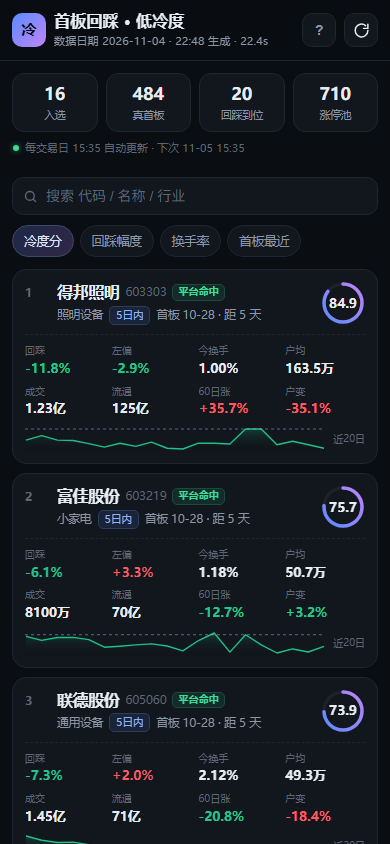
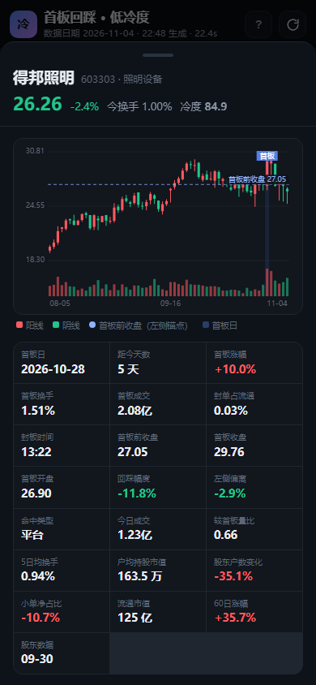
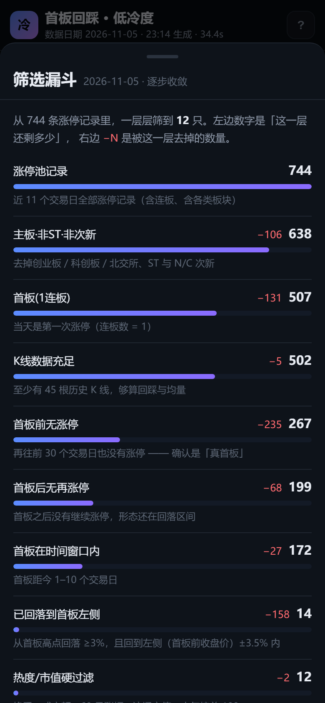

# 手机 App · 首板回踩低冷度选股

把电脑上的选股系统搬到了手机上：**一个可以在手机上直接用的 App，每天收盘后自动更新名单**，不需要装应用商店，也不用第三方依赖（后端只用了 Python 标准库）。

- 数据、四条件、冷度分口径与电脑版 `run.py` 完全一致
- 每个交易日 **15:40 自动重跑**一次，生成当天名单
- 手机打开就能看：排名、指标、K 线、评分构成、历史日期

```
手机浏览器（PWA）
      │ 同一 WiFi
      ▼
app.py  ←── 15:40 定时任务 / 手动刷新
      │
      ├─ 东财行情·涨停池·K线
      ├─ 股东户数·人气榜·龙虎榜·资金流
      └─ data/snapshot_2026-11-04.json
```

| 名单 | 详情（K 线 + 22 项指标） | 筛选漏斗（点顶部数字） |
| --- | --- | --- |
|  |  |  |

> **想在外面（不用电脑、不在家）也能看？** 用云端版：<https://ybl120579.github.io/stock-screener/>，
> 由 GitHub Actions 每个交易日 15:40 自动跑、GitHub Pages 托管，手机 4G/5G 直接打开。
> 本文件是「本地版」，见 [CLOUD.md](../CLOUD.md) 了解云端版。

---

## 一、三步开始

### 1. 放行防火墙（手机打不开时才需要）

先直接试第 2、3 步。如果手机浏览器一直转圈打不开，再双击 **`放行手机访问-需要管理员.bat`**，弹窗里点「是」——
它会为 TCP 8765 端口加一条入站放行规则。多数电脑其实已经允许 `python.exe` 入站，当前 WiFi 属于"公用网络"时也能连。

### 2. 启动服务

双击 **`启动手机App服务.bat`**，窗口里会打印出两个地址：

```
电脑上打开   http://127.0.0.1:8765
手机上打开   http://192.168.31.112:8765    （同一 WiFi）
每日自动更新 交易日 15:40（服务需保持运行）
```

**这个窗口保持开着**就是服务在跑，关掉窗口 = 停止服务。

### 3. 手机打开

手机连上和电脑**同一个 WiFi**，浏览器输入窗口里那个 `192.168.x.x:8765` 地址。

第一次打开会拉取最新名单，大约 1 秒。

---

## 二、装到主屏幕（变成"App"）

不用装任何东西，从浏览器把它装成图标就行：

| 手机 | 操作 |
| --- | --- |
| iPhone / iPad（Safari） | 底部「分享」→ 向下滑 →「添加到主屏幕」 |
| Android（Chrome / Edge） | 右上角 ⋮ →「安装应用」或「添加到主屏幕」 |

装好后点图标是**全屏无地址栏**的，和原生 App 一样；断网时会显示上一次缓存的名单（标注「离线」）。

---

## 三、每天自动更新

| 场景 | 行为 |
| --- | --- |
| 交易日 15:40，服务在跑 | 自动重跑筛选，写入当天快照 |
| 15:40 时电脑关着 | **下次启动服务时立刻补跑**当天（不会漏） |
| 当天已经跑过 | 不会重复跑，界面显示名单生成时间 |
| 手动更新 | 右上角刷新按钮，或列表下拉 |
| 想换时间 | 启动时加参数，例如 `启动手机App服务.bat --schedule 16:10` |

> 定时只在**交易日**触发，节假日不跑；判断交易日用的是上证指数行情日历。

**开机自启**（推荐）：双击 `开机自启-安装.bat`，之后每次登录 Windows 会在后台最小化启动服务。
取消自启运行 `开机自启-取消.bat`。

---

## 四、界面上有什么

- **顶部 4 个数字**：入选 / 真首板 / 回踩到位 / 涨停池，一眼看今天筛下来多少
- **自动更新状态行**：绿色小圆点 +「每交易日 15:40 自动更新 · 下次 11-05 15:40」
- **排序**：冷度分 / 回踩幅度 / 换手率 / 首板最近
- **搜索**：代码、名称、行业模糊匹配
- **卡片**：名称、行业、5日内或10日内、首板日与距今天数、命中类型（平台/开盘价）、冷度分圆环，8 个核心指标 + 近 20 日走势
- **点卡片进详情**：60 根 K 线（首板高亮 + 左侧锚点虚线）、22 项指标、冷度分构成条
- **历史日期**：积累多天后顶部会出现日期标签，点一下切回旧名单（离线也能看）
- **右上角 ?**：应用内说明页，把四条件、冷度分权重、更新机制写在里面

---

## 五、常见问题

**手机打不开 / 一直转圈**
1. 手机和电脑是同一个 WiFi 吗？（手机用蜂窝网络不行）
2. 电脑上的窗口还开着吗？
3. 防火墙放行了吗？——再跑一次 `放行手机访问-需要管理员.bat`
4. 电脑 IP 变了？看启动窗口里打印的地址，以它为准

**提示端口被占用**
说明已经有一个在跑（比如开机自启的）。直接访问那个地址即可；确实要换端口：
`启动手机App服务.bat --port 8766`

**接口地址 / 防火墙规则**
`netsh advfirewall firewall show rule name="首板冷度选股-8765"`
删除规则：`netsh advfirewall firewall delete rule name="首板冷度选股-8765"`（管理员）

**想放到公网给外面访问**
不建议直接暴露：`app.py` 没有登录鉴权。要远程看，用 Tailscale / 内网穿透之类的方案，或者自己加一层 Nginx + Basic Auth。

---

## 六、目录结构

```
mobile/
├── app.py                     后端：HTTP 服务 + 快照 + 定时任务（无第三方依赖）
├── ui/
│   ├── index.html             页面骨架
│   ├── style.css              深色主题样式
│   ├── app.js                 前端逻辑（原生 JS，无框架）
│   ├── manifest.webmanifest   PWA 清单
│   ├── sw.js                  Service Worker（离线缓存）
│   └── icon-*.png             主屏图标（make_icons.py 生成）
├── data/
│   └── snapshot_2026-11-04.json   每日快照（含名单与漏斗）
├── make_icons.py              生成图标
├── dev/cdp_shot.js            截图脚本（CDP，node，无依赖）
├── dev/shot.js                旧截图脚本（iframe 方案）
├── shots/                     截图（README 里引用）
├── 启动手机App服务.bat
├── 开机自启-安装.bat
├── 开机自启-取消.bat
└── 放行手机访问-需要管理员.bat
```

### HTTP 接口

| 方法 | 路径 | 说明 |
| --- | --- | --- |
| GET | `/api/list` | 最新（或 `?date=YYYY-MM-DD` 指定）名单快照 |
| GET | `/api/stock/603303` | 单只股票详情（含 60 根 K 线） |
| GET | `/api/history` | 已有快照的日期列表 |
| GET | `/api/status` | 运行状态、下次自动更新时间 |
| POST | `/api/refresh` | 立刻重跑（单飞，重复请求会被忽略） |

---

## 七、说明

- 数据来自东方财富公开接口（行情、涨停池、股东户数、人气榜、龙虎榜、资金流），免费但**不保证稳定**，接口变动时可能取不到数据
- 冷度分只衡量「热度低 / 散户少 / 缩量」的程度，**不代表上涨概率**，也不是买入信号
- 本工具只做筛选与展示，不构成任何投资建议，风险自担
